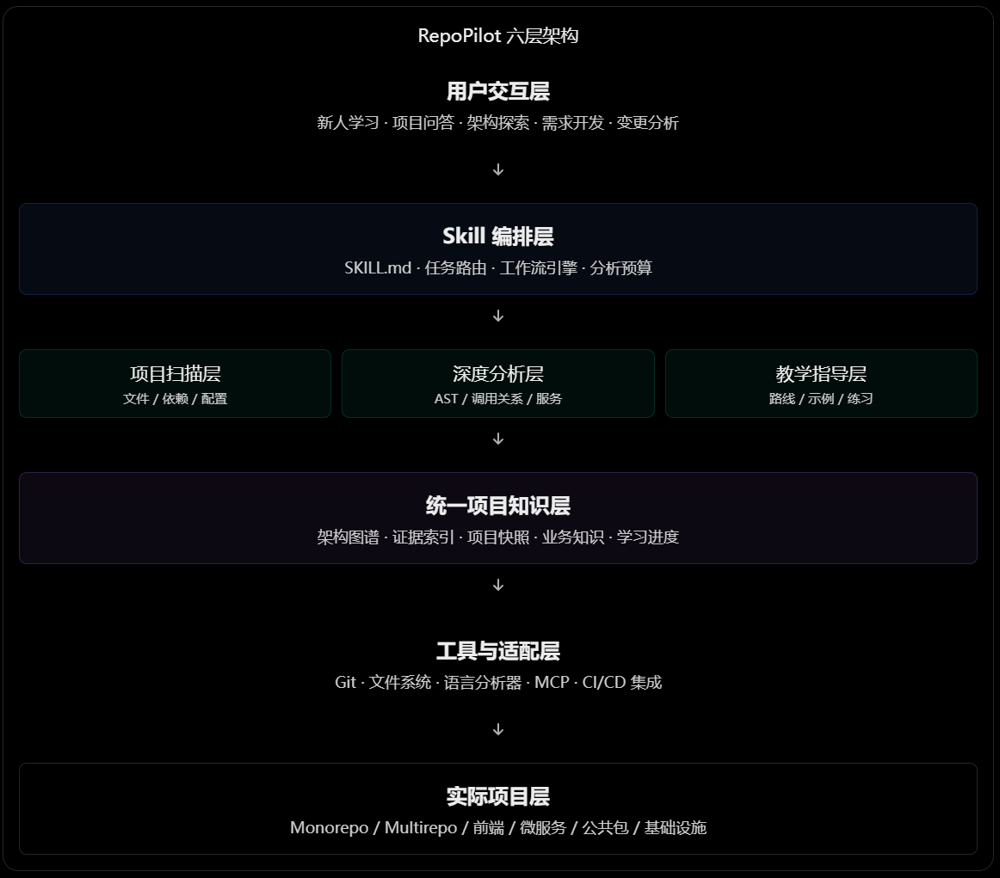

<div align="center">
    
</div>

<div align="center" >一个能自动探索项目结构、梳理技术架构、追踪业务链路，并按照真实开发流程指导新人上手的 AI Skill</div>

<div align="center">
  <p>
    <a href="LICENSE"></a>
    <a href="#4-安装-installation"></a>
    <a href="#6-skill-索引"></a>
  </p>
  <p>
    <a href="#4-安装-installation">安装</a> ·
    <a href="#3-快速开始">快速开始</a> ·
    <a href="#6-skill-索引">Skill 索引</a> ·
    <a href="#7-仓库结构">仓库结构</a>
  </p>
</div>

---

## 目录

- [1. 设计思想](#1-设计思想)
- [2. 整体运行架构](#2-整体运行架构)
- [3. 快速开始](#3-快速开始)
- [4. 安装 Installation](#4-安装-installation)
  - [4.1 `npx skills` 安装](#41-npx-skills-安装)
  - [4.2 Claude Code 安装](#42-claude-code-安装)
  - [4.3 Codex 安装](#43-codex-安装)
- [5. 为什么文档站不会被一起装走](#5-为什么文档站不会被一起装走)
- [6. Skill 索引](#6-skill-索引)
- [7. 仓库结构](#7-仓库结构)

## 1. 设计思想

RepoPilot 不应该一次性把整个仓库解释完，而是先构建项目地图，再根据使用者当前的目标，按需深入代码。

同一个仓库，四个目标对应四条完全不同的路径：跑起来、改功能、排查问题、熟悉业务。所以 RepoPilot 一定会先确认你要做什么，再决定往哪走。

## 2. 整体运行架构

<div align="center">
    
</div>

## 3. 快速开始

安装后直接对 agent 说话即可，下面这些提示词可以复制：

| 目标     | 提示词                                                 |
| -------- | ------------------------------------------------------ |
| 跑起项目 | `帮我把这个仓库跑起来，告诉我每一步和可能卡住的地方。` |
| 理清架构 | `帮我理清这个项目的架构，先给我一张地图。`             |
| 熟悉代码 | `我是新接手的人，告诉我按什么顺序看这份代码。`         |
| 追链路   | `这条下单链路从哪里进、到哪里结束，中间有哪些分支。`   |
| 定位功能 | `订单状态是在哪里变更的，改动会影响哪些模块。`         |

不确定用哪个能力就直接描述任务；明确知道名字时，可以在提示词里写「用 `repo-pilot`」。

## 4. 安装 Installation

每个 `skills/` 下的顶层目录都是一个可安装单元。**仓库根不需要、也不应该有 `SKILL.md`**，否则会遮蔽 `skills/` 下的正式入口。

### 4.1 `npx skills` 安装

先安装 [Node.js 18 或更高版本](https://nodejs.org/)。CLI 无需全局安装。

列出本仓库可用的 skill：

```bash
npx skills add resinya/RepoPilot --list
```

装到当前项目（会随仓库提交给同事）：

```bash
npx skills add resinya/RepoPilot --skill repo-pilot --yes --copy
```

装到用户级，所有项目可用：

```bash
npx skills add resinya/RepoPilot --global --skill repo-pilot --yes --copy
```

指定目标 agent：

```bash
npx skills add resinya/RepoPilot --agent codex --global --skill repo-pilot --yes --copy
```

> `--copy` 表示落盘而非软链。默认是符号链接，清理 CLI 缓存后可能失效，所以文档里统一推荐 `--copy`。

验证与更新：

```bash
npx skills list --global --json
npx skills update repo-pilot --global --yes
```

### 4.2 Claude Code 安装

保留一份稳定克隆，再建一个 subagent 或 slash command 包装指向真实的 `SKILL.md`。这样能完整保留 `references/` 等目录结构。

```bash
mkdir -p ~/ai-skills
git clone https://github.com/resinya/RepoPilot.git ~/ai-skills/RepoPilot
```

创建 subagent 包装：

```bash
mkdir -p ~/.claude/agents
cat > ~/.claude/agents/repo-pilot.md <<'EOF'
---
name: repo-pilot
description: Use for exploring an unfamiliar repository, building a project map, tracing business flows, and onboarding newcomers.
---

When invoked, first read `~/ai-skills/RepoPilot/skills/repo-pilot/SKILL.md` and follow it as the governing workflow.
Read supporting files from `~/ai-skills/RepoPilot/skills/repo-pilot/references/` only when needed.
Do not replace this skill with a generic architecture explanation.
EOF
```

新开一个会话后直接调用：

```text
Use the repo-pilot subagent to help me run this repository.
```

后续更新只需 `cd ~/ai-skills/RepoPilot && git pull`。

### 4.3 Codex 安装

```bash
npx skills add resinya/RepoPilot --agent codex --global --skill repo-pilot --yes --copy
```

也可以让 Codex 自己装：

```text
Install the repo-pilot skill from https://github.com/resinya/RepoPilot
Run npx skills add resinya/RepoPilot --agent codex --global --skill repo-pilot --yes --copy
Keep the complete skill directory, not just SKILL.md.
```

**关键规则**：必须保留完整目录结构。skill 依赖 `references/` 与 `manifest.yaml`，只拷 `SKILL.md` 会让按需加载失效。

装完后**开一个新会话**，然后自然描述任务：

```text
帮我理清这个项目的架构，先给我一张地图。
```

## 5. 为什么文档站不会被一起装走

`skills` CLI 的工作方式是「先扫描、再拷贝单个目录」：克隆仓库 → 扫出所有 `SKILL.md` → **只把命中的那个 skill 目录**写入 agent 的 skills 目录。

写入的是 `skills/repo-pilot/` 这一层，不是仓库根，因此 `site/`（文档站源码）天然被排除。

两条硬性约束：

1. **仓库根不能放 `SKILL.md`** —— 根级会遮蔽 `skills/` 下的正式入口。
2. **文档站里不能出现真实的 `SKILL.md` 文件** —— CLI 在标准位置找不到时会递归全仓库搜索，示例文件会被误当成第二个 skill。文档里的示例一律用 `.mdx` 或代码块。

CI 里已钉死第二条，见 `.github/workflows/validate-skill.yml`。

## 6. Skill 索引

| Skill                                       | 状态  | 用途                                                 | 触发示例                                                                         | 详情                                |
| ------------------------------------------- | ----- | ---------------------------------------------------- | -------------------------------------------------------------------------------- | ----------------------------------- |
| [`repo-pilot`](skills/repo-pilot/README.md) | Draft | 探索陌生仓库：项目地图、架构分层、业务链路、上手路径 | 「这个仓库怎么跑起来」「帮我理清这个项目」「新人怎么熟悉代码」「这条链路怎么走」 | [详情](skills/repo-pilot/README.md) |

状态含义：`Draft` 规则已定义但未在真实案例验证 · `Beta` 已验证但有边界问题 · `Stable` 已在真实项目验证。

## 7. 仓库结构

```text
RepoPilot/
├── skills/                  # ★ 唯一会被安装的部分
│   └── repo-pilot/
│       ├── SKILL.md         # agent 加载的入口（必需）
│       ├── README.md        # 中文人读文档
│       ├── README_EN.md     # 英文人读文档（与中文镜像）
│       ├── manifest.yaml    # 声明式按需加载清单
│       └── references/      # 按需加载的规则文件
├── site/                    # 官方文档站（Fumadocs + Next.js），永不进入安装产物
├── scripts/                 # 校验脚本
├── .github/workflows/       # CI：校验 skill 元数据 + 部署文档站
├── LICENSE
└── .gitattributes           # 强制 LF，避免 .sh 在 Linux 上报 ^M
```

## 许可证

[MIT](LICENSE)
