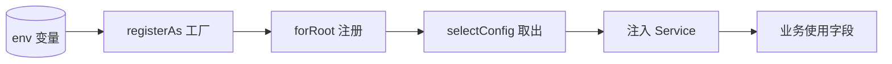

# 正例：骨架优先 + 讲透配置与模块（NestJS 风格教学示例）

## 输入与证据约束

合成教学夹具：项目用 NestJS，`config/configuration.ts` 用 `registerAs` 定义账户配置，`app.module.ts` 用 `@Module` 组装。字段与角色是演示条件，不是私有仓库源码。正式输出须附实读行号和准确版本依据；不能复制路径就声称读过。

---

# 一、先给模块骨架（原则一）

最小可运行语法——只有框架要求的结构，无业务：

```ts
// 框架给的：一个空的模块类，没有任何业务
@Module({})
export class AppModule {}
```

叠加业务后的样子，逐行区分默认与新增：

```ts
@Module({
  imports: [ConfigModule, UserModule], // 新增：引入配置与用户模块
  controllers: [AuthController],      // 新增：注册控制器（接收请求）
  providers: [AuthService],           // 新增：注册服务（处理业务）
  exports: [AuthService],             // 新增：暴露给别的模块复用
})
export class AppModule {}
```

结论：框架只要求 `@Module({})` 这一个装饰器；`imports` / `controllers` / `providers` / `exports` 全是项目按业务填的。不理解业务时，至少要知道 `imports` 管依赖、`controllers` 管入口、`providers` 管实现——**不要把 import 进来的三方库当成框架内置**。

# 二、再讲配置字段（原则三）

这个账户配置模块实际有哪些字段，而不是只说“包含用户与密码配置”：

```ts
username         // 用于登录的用户昵称
defaultPassword  // 系统登录的默认密码
tokenExpiresIn   // 登录令牌有效期（秒）
maxLoginAttempts // 锁定前最大尝试次数
```

来源：`username` / `tokenExpiresIn` 来自 env，`defaultPassword` 是代码默认值，`maxLoginAttempts` 来自配置工厂。模板与完整表见 [config-guide](../../assets/templates/config-guide.md)。

# 三、剖析配置函数（原则三·函数剖析）

遇到 `selectConfig(ConfigModule, Config)` 这类“取出配置”的函数，按四问剖析，并判断它是否框架内置：

| 维度 | 内容 |
| --- | --- |
| 是否框架内置 | **否**——这是项目对 `@nestjs/config` 的 `ConfigModule.select` / `Inject` 的封装（依据：定义在项目 `config/` 目录，不在 node_modules） |
| 入参 | `(ConfigModule：承载配置的模块；Config：registerAs 导出的配置 Token / 形状)` |
| 出参 | 强类型配置对象，可在同模块构造函数中注入 |
| 数据流 | env → `registerAs` 工厂 → `forFeature` 注册 → `selectConfig` 取出 → 注入 `AuthService` 消费 |
| 配置内部流程 | 读取 env → 合并默认对象 → 校验 → 注册为可注入 Provider → 取出 → 字段被 `AuthService` 用于登录校验 |

用户关心的“内置吗、传什么、出什么、怎么起作用”全部落到这张表，而不是停留在“这是一个配置函数”。

# 四、区分框架默认与项目封装（原则二）

框架开箱默认（趋势）：

```ts
ConfigModule.forRoot() // 默认读取 process.env 全部变量，非全局
```

项目封装（逐层标明覆写点）：

```ts
ConfigModule.forRoot({
  isGlobal: true,               // 覆写：全局可用，省去每模块重复 import
  load: [configuration],        // 覆写：加载 registerAs 配置工厂
  validationSchema: envSchema,  // 覆写：启动时校验环境变量
})
```

每一层覆写都说明它解决什么：`isGlobal` 省重复 import、`load` 做分层配置、`validationSchema` 防错配。**不把项目覆写当成框架默认，也不把默认当成项目实现。**

# 五、技术栈前置简报（原则四）

走读前先列出本流程用到的技术栈并询问：

> 这一步会用到：NestJS 依赖注入、`@nestjs/config`、`registerAs` 模式、装饰器。
> 你哪些不熟悉？我先做简报。

对用户指明的“`@nestjs/config` 不会”，简报给出：

- **白话**：它把环境变量变成类型安全的配置对象，可全局注入，避免到处读 `process.env`。
- **本项目用法**：`configuration.ts` 用 `registerAs('account', ...)` 定义，`AppModule` 用 `forRoot({ load })` 加载。
- **常用 API**：`forRoot` / `forFeature` / `registerAs` / `ConfigModule.select` / `Inject`（5 个足矣，不凑）。
- **调用关系**：env → `registerAs` → `forRoot` 注册 → `selectConfig` 取出 → 注入。
- **使用流程图**（Mermaid，按 diagrams 契约给可编辑图源）：



简报后再进入原 walkthrough，用户不再因技术陌生而卡住；简报若已到 library 深度，转完整 [library](../../references/workflows/library.md) 流程。

---

## 为什么这是正例

骨架先于业务，配置枚举真实字段，配置函数讲清出入参与数据流，框架默认与项目封装分层标注，陌生技术先简报。读者能分开“框架给的”和“项目加的”，知道配置传什么、出什么、怎么生效——而不是收到一份只说“这是配置 / 这是模块”的空泛说明。
