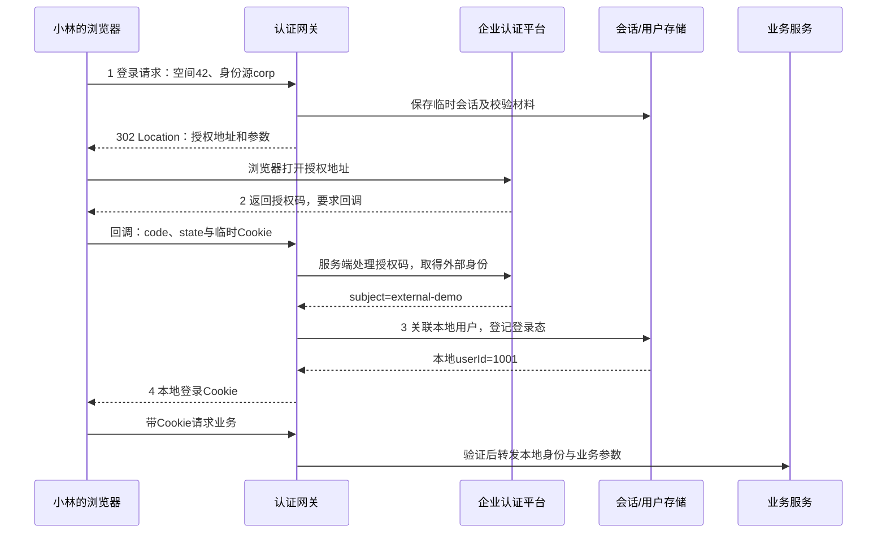

# 正反例：一页完整看懂，点击只作辅助

演示用[业务地图模板](../../assets/templates/business-map.html)和合成 web-api 夹具，不包含企业服务地址、源码拷贝、凭据或用户资料。主题是“打开订单列表”，不是模拟运行订单系统。

## 请求

“把模块和请求数据流可视化，告诉我每步传什么、变成什么。能放一起就放一起，不要一直点来点去。”

## 正例成果

只交一个 index.html，页面从上到下包含：

1. 一个连续模拟案例、范围与事实状态；示例值统一。
2. 完整时序图：页面、浏览器请求层、API和内存数据是固定参与者，箭头注明谁传给谁。
3. 四个较大阶段：触发、网络请求、业务查询、响应显示都在同页，导航仅定位/高亮，不隐藏其他阶段。
4. 同号消息旁直接显示请求/JSON/内部参数样子、字段含义、具体来源和结果；不能只给“输入/输出”两张概念卡。
5. 模块职责、负责文件和长证据就近查阅；来源与部署断点可见。

用户滚动即可形成连续认知。多个协议确实存在时可切换场景，切换后仍展示该场景全部步骤。没有必要同时展出所有协议的重复流程。

夹具中的 GET /orders 与 API 路由能静态匹配，但未有代理部署证据；页面明确标连接未知。API读的是内存数组，不能画数据库。请求函数会抛出错误，页面未见错误 UI，不能补造错误弹窗。

## 合成登录案例：谁传配置，谁传回调

以下仅是模拟输出设计，用于校准表现，不替代任何项目源码。假设小林访问空间42，管理员已在网关保存企业身份源配置，网关使用OIDC授权码方式；用户材料和登录策略都是演示假设。



同页分四阶段讲，不按每条箭头拆页面。以第一阶段的返回消息为例：

```text
谁发给谁：认证网关 → 浏览器
传递形式：HTTP 302响应中的Location

Location: https://idp.example.invalid/authorize?
  client_id=demo-app&redirect_uri=<网关回调地址>
  &scope=openid&state=state-demo
```

| 字段 | 谁提供 | 含义 |
| --- | --- | --- |
| 空间42、corp | 浏览器登录URL | 用户选择的业务范围和身份源 |
| client_id=demo-app | 管理员事先保存的配置，网关读取 | 认证平台识别应用 |
| redirect_uri | 网关按接入配置构造 | 外部平台完成后回哪里 |
| state-demo | 网关生成，外部平台按协议回传 | 关联发起和回调 |

所以网关是这条响应的发送方，但不是所有字段的最初来源。浏览器接到302后，再请求外部平台；不能画成网关自己去客户登录页。回调的code来自外部平台，临时Cookie来自网关之前的响应，期望校验值来自存储。对象、URL和header示例就近展示，模拟值不声称可用于真实登录。

## 反例一：依赖点选才能理解

首页只有四个模块名。点击进入新视图，必须再点输入、再点处理、再点输出；步骤每次只展示一张卡，用户不能对比前后字段，返回后当前位置丢失。

修正：把当前场景的核心职责和完整步骤放回同一页；导航是快捷定位，收起只留给长源码和补充证据。用户明确喜欢钻取时才作为可选布局，仍保留完整摘要。

## 反例二：十份产物拼答案

交模块.md、请求.md、输入.md、输出.md、配置.md、API.md、前端.md、服务.md、图.md和说明.md，每份只有几句话。

修正：一条场景整合进同一文档/页面；全量依赖索引才独立附录，不为阶段或层级创建文件。

## 反例三：图漂亮但数据没解释

节点只写 Controller → Service → DB，线条不标内部/网络/状态关系，所有字段叫 data；或只列issuer/client_id而没有案例、方向和来源；把生成图片称作可交互业务地图。

修正：一个案例贯穿完整时序，技术细跳合入较大阶段；具体输入样子、来源、转换和结果同处可读，未知保留。实际产物是 HTML、Mermaid图源或图片就各称其名。

## 验收

未点任何按钮就能读完主场景；目录锚点、场景切换、证据展开、刷新定位和小屏经过实际检查；脚本语法通过不冒充浏览器验收，更不等于真实服务运行成功。
