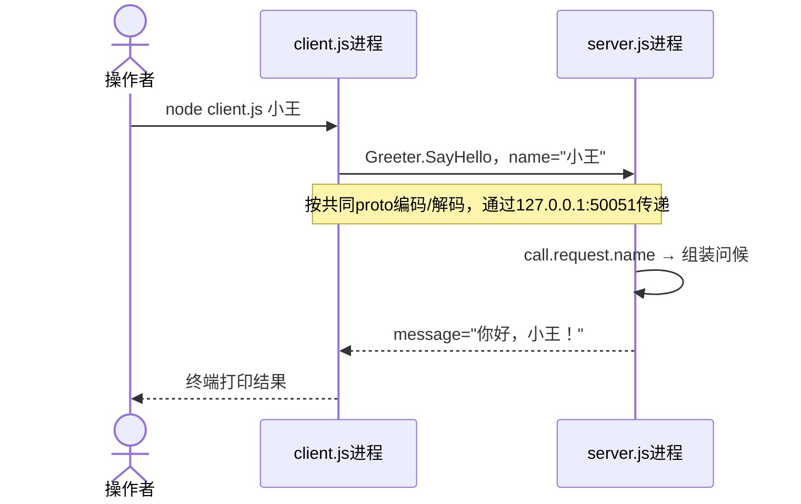

# 技术预备正反例：先最小实现，再回项目

以下是合成演练，不含企业源码或真实项目版本。第一轮探测后的清单举例：

| 技术/依赖 | 作用与所在范围 | 证据状态 |
| --- | --- | --- |
| React | Web应用的页面组件 | 已读入口；版本按该应用清单 |
| RPC/gRPC | 调用另一进程提供的方法 | 当前调用者/契约是否采用gRPC须实读，不凭“RPC”名称确定 |
| 本地 shared 包 | 多应用共享的请求/类型封装 | workspace声明与import需分别核对 |

Agent问：“哪些不熟悉？列名称/编号即可；会先在目标根技术栈demo里生成完整示例文档，也可说都熟悉/跳过或只在会话看。”用户答：“RPC不会，先用gRPC给最小Demo”。此选择允许生成文档，不允许默认安装或启动。下文是该项 README 的完整正例；实际项目未确认gRPC时，说明这是用于理解RPC的教学实现，不能判定项目采用了gRPC。

---

# 技术栈的使用：gRPC 最小 Demo

本例只做一件事：客户端传入“小王”，另一个进程返回“你好，小王！”。RPC 可以理解为“通过网络请求另一进程执行方法”；gRPC 是一种具体实现。双方共用 `.proto` 契约，客户端知道地址和方法，不导入服务端实现。

教学运行时 Node.js 20+；教学依赖 `@grpc/grpc-js` 1.13.4、`@grpc/proto-loader` 0.8.1。它们是本例明确选择的版本，不是目标项目安装版。下面值全部合成，仅监听本机。实际验证状态见文末。

## 文件树与职责

文档默认保存在 `技术栈demo/grpc/README.md`，完整源码放在以下代码块。用户要求落地后在同一目录创建四个文件：

```text
grpc/
├── README.md       # 本文，代码和流程一起读
├── package.json    # 固定依赖与两个启动命令
├── hello.proto     # 双方接口约定：方法、参数、返回值
├── server.js       # 真正执行方法的服务端进程
└── client.js       # 发请求并消费结果的客户端进程
```

## 完整最小实现

### package.json

```json
{
  "name": "repopilot-grpc-demo",
  "version": "1.0.0",
  "private": true,
  "type": "commonjs",
  "engines": { "node": ">=20" },
  "scripts": { "server": "node server.js", "client": "node client.js" },
  "dependencies": {
    "@grpc/grpc-js": "1.13.4",
    "@grpc/proto-loader": "0.8.1"
  }
}
```

grpc-js提供网络服务和客户端；proto-loader读取契约，不编译目标项目。安装会在本Demo目录新增锁文件和node_modules，不能在项目根执行。

### hello.proto

```proto
syntax = "proto3";
package tutorial;

service Greeter {
  rpc SayHello (HelloRequest) returns (HelloReply);
}
message HelloRequest {
  string name = 1;
}
message HelloReply {
  string message = 1;
}
```

`Greeter`提供`SayHello`方法，接收带`name`的请求，返回带`message`的结果。`1`是字段编号，用于编码；不是示例值。

### server.js

```javascript
const grpc = require('@grpc/grpc-js');
const protoLoader = require('@grpc/proto-loader');
const path = require('node:path');

const definition = protoLoader.loadSync(path.join(__dirname, 'hello.proto'));
const tutorial = grpc.loadPackageDefinition(definition).tutorial;
const address = `127.0.0.1:${process.env.DEMO_PORT || '50051'}`;
const server = new grpc.Server();

server.addService(tutorial.Greeter.service, {
  sayHello(call, callback) {
    const name = call.request.name;
    console.log(`收到 name: ${name}`);
    callback(null, { message: `你好，${name}！` });
  }
});

server.bindAsync(address, grpc.ServerCredentials.createInsecure(), (error) => {
  if (error) {
    console.error(error.message);
    process.exitCode = 1;
    return;
  }
  console.log(`服务端监听 ${address}`);
});

process.on('SIGINT', () => {
  server.tryShutdown((error) => {
    if (error) {
      console.error(error.message);
      process.exitCode = 1;
    }
  });
});
```

注册把契约方法绑定到处理函数；`call.request`是客户端输入，`callback(null, reply)`的首参`null`表示成功。选定版本绑定后无需调用已弃用的`server.start()`。本例无TLS只用于本机教学，不能照搬到生产服务。

### client.js

```javascript
const grpc = require('@grpc/grpc-js');
const protoLoader = require('@grpc/proto-loader');
const path = require('node:path');

const definition = protoLoader.loadSync(path.join(__dirname, 'hello.proto'));
const tutorial = grpc.loadPackageDefinition(definition).tutorial;
const address = `127.0.0.1:${process.env.DEMO_PORT || '50051'}`;
const client = new tutorial.Greeter(address, grpc.credentials.createInsecure());
const name = process.argv[2] || '小王';

client.sayHello({ name }, { deadline: new Date(Date.now() + 5000) }, (error, reply) => {
  if (error) {
    console.error(`调用失败: ${error.code} ${error.details}`);
    process.exitCode = 1;
  } else {
    console.log(reply.message);
  }
  client.close();
});
```

客户端没有导入`server.js`。stub是按契约提供方法的客户端对象，调用它会发送网络请求；结果异步进入回调。五秒deadline防止无限等待；`close()`释放客户端连接。

## 一次操作的数据流程



| 步骤 | 谁提供数据 → 谁消费 | 对象/处理结果 |
| --- | --- | --- |
| 1 | 操作者 → 客户端 | CLI参数`小王`；未给参数则用合成默认名 |
| 2 | 客户端 → 服务端 | JS请求对象`{ name: "小王" }`，线上是protobuf编码数据 |
| 3 | 服务端处理函数 → 回调 | JS返回对象`{ message: "你好，小王！" }` |
| 4 | 客户端回调 → 终端 | 消费reply.message并关闭连接 |

地址来自本例默认值或`DEMO_PORT`，不是用户请求体。双方持有契约文件不表示双方共用一个进程。

## 运行与观察

以下是操作说明，生成文档不会自动执行。用户要求落地/运行后，把四个文件写入本Demo目录；先确认Node/npm可用，再在该目录安装：

```powershell
cd <目标项目根>/技术栈demo/grpc
npm install --ignore-scripts --no-audit --no-fund
```

终端A（仍在grpc目录）：

```powershell
npm run server
```

预期：`服务端监听 127.0.0.1:50051`。保持该终端打开，在终端B同目录执行：

```powershell
node client.js 小王
```

客户端预期输出`你好，小王！`，服务端新增`收到 name: 小王`。再传“小李”应返回“你好，小李！”；它帮助观察输入如何改变结果。

结束：终端A按Ctrl+C，服务端停止；客户端已自动关闭连接。此后再运行客户端应出现`调用失败`、非零退出码，通常是UNAVAILABLE；不要把未连上服务当成方法正常返回。若端口占用，在两个终端都先设置`$env:DEMO_PORT='50052'`再重试；执行结束可`Remove-Item Env:DEMO_PORT`清除当前终端变量。不关闭未知占用进程。

## 本例用到的API

| API | 文件/作用 | 输入与结果 |
| --- | --- | --- |
| protoLoader.loadSync | 双方加载契约 | proto路径 → package definition |
| grpc.loadPackageDefinition | 双方创建类型/服务描述 | definition → tutorial命名空间 |
| grpc.Server / addService | 服务端注册处理函数 | service描述+处理器 → 本地服务注册 |
| bindAsync | 服务端开始接受请求 | 地址+凭据 → 成功/错误回调 |
| new tutorial.Greeter / sayHello | 客户端创建stub/发请求 | 地址、请求、deadline → 异步reply或error |
| credentials / ServerCredentials | 两端凭据 | 本例createInsecure用于本机无TLS教学 |
| close / tryShutdown | 客户端/服务端清理 | 释放连接 / 等待在途请求后停止 |

## 回到项目：找对应位置

本合成案例没有目标项目源码，以下是搜索角色，不是已确认路径。实际交付必须替换为实读文件/符号，不能把这个待查表当作项目分析完成。

| Demo角色 | 项目需要查什么 | 当前状态 |
| --- | --- | --- |
| hello.proto | 实际契约/协议定义；是否是gRPC或另一个RPC方案 | 待确认 |
| 创建stub与sayHello | 真实调用者及项目Client/Wrapper；谁传参 | 待确认 |
| addService处理函数 | 实际服务注册、路由/消息处理器、框架包装 | 待确认 |
| address | 配置/服务发现及部署边界 | 待确认，不读取真实密钥 |
| reply消费 | 哪个页面/业务函数处理结果或错误 | 待确认 |

本例省略鉴权、重试、日志、服务发现和业务数据；项目的Model/Wrapper或Nest注册必须继续读源码。看完后回复“继续”，回原模块分析；也可先指出客户端、契约、服务端哪一步还不清楚。不用考试证明掌握。

## 来源与状态

RepoPilot 0.6.0，demo任务；2026-10-13编写的公开合成案例，无目标revision/项目版本。依据：[官方Node入门](https://grpc.io/docs/languages/node/basics/)、[grpc-js接口](https://github.com/grpc/grpc-node/blob/master/packages/grpc-js/README.md)、[proto-loader](https://github.com/grpc/grpc-node/blob/master/packages/proto-loader/README.md)。本例固定教学版本；API按官方仓库核对，不代表未知项目版本适用。

运行验证：2026-10-13，Node.js 20.19.1，固定依赖1.13.4/0.8.1，在RepoPilot隔离验证目录安装依赖后运行文档中原样四文件；测试用本机临时端口。小王、小李及默认名均返回匹配问候，服务端收到相应name；服务端停止后客户端报告UNAVAILABLE（14）且退出码1。测试进程/临时源码已清理。验证未覆盖手动Ctrl+C优雅停止、生产TLS、目标项目RPC连通或用户掌握程度。其他平台按本文步骤验证，不宣称已通过。

---

## 反例与改法

- **不问直接出全项目架构**：用户其实不会RPC，却收到术语密集的微服务图。改为先给相关技术用途/本地包消费表，等其选择陌生项。
- **问遍锁文件**：列三百个间接包要求逐一确认。改为只选当前主线；已明确熟悉/跳过/继续不重问。
- **源码碎成多个文档**：grpc概念、proto、client、server、启动、API各一份，来回点。改为一个技术文件夹一份自足README，文件树与全部代码在一起。
- **只有函数片段**：`client.call(...)`无契约/依赖/注册/运行结果却称可运行。改为完整匹配的四文件实现与操作，或坦率标成伪代码示意。
- **RPC偷换技术**：看到内部包import就认定gRPC，或把monorepo解释成跨进程调用。改为分清包依赖与通信，教学方案和实际项目方案分别说明。
- **自动执行与覆盖**：收到“我不会”就在业务包npm install并启动真实服务。改为默认只生成文档；实际源码隔离到Demo子目录，安装/运行依具体授权。
- **学完失去主线**：交完例子从全仓重新扫描，或直接写“你已经掌握”。改为保留原应用/版本/位置，等待用户继续，不把生成/运行当掌握。
